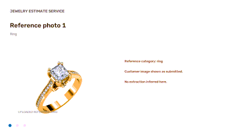

# Jewelry Estimate Service

Turn a short product brief and optional reference photo into structured specs, ranked
catalog matches, an image estimate, and confidence/review flags.

**Domain:** fine jewelry—rings, chains, necklaces, bracelets, earrings, and pendants.

## Demo

The GIF compares each reference photo with its closest catalog product image:



## Run locally

Python 3.11+ is recommended.

```powershell
python -m venv .venv
.\.venv\Scripts\Activate.ps1
pip install -r requirements.txt
python scripts\build_catalog_index.py
uvicorn app.main:app --reload
```

Open [http://127.0.0.1:8000](http://127.0.0.1:8000). Upload a jewelry photo and add a
brief, or click one of the sample photos. The results show the uploaded reference and
the retrieved catalog product image.

The catalog photos are cached from the CSV listing URLs, with licensed Wikimedia
fallbacks where a listing cannot be fetched. They are committed in `data/images/`.
Refresh them and rebuild the search index with:

```powershell
python scripts\fetch_inventory_images.py --force
python scripts\build_catalog_index.py --force
```

## Optional Gemini models

The service works without an API key using local extraction and OpenCV. Set
`GEMINI_API_KEY` in `.env` to enable Gemini extraction, vision, and multimodal embeddings.
After changing embedding backends, rebuild the index:

```powershell
python scripts\build_catalog_index.py --force
```

Never commit API keys. See `.env.example` for available settings.

## API

`POST /analyze` accepts JSON with a brief and optional image data URL, or a multipart
upload:

```powershell
curl.exe -X POST http://127.0.0.1:8000/analyze `
  -F "brief=18K gold diamond ring" `
  -F "image=@reference.jpg;type=image/jpeg"
```

Other endpoints: `POST /search`, `GET /inventory/{sku}`,
`GET /inventory/{sku}/image`, and `GET /health`.

## Design and limitations

- Pydantic validates extracted specifications. If model output fails, the service uses
  its labeled local fallback and reports confidence and reasons.
- Retrieval uses Qdrant; a deterministic weighted matcher ranks results. Semantic
  similarity (0.25), image similarity (0.20), item type (0.18), metal (0.15), purity
  (0.09), gemstone (0.08), and weight (0.05) are scored. Missing-signal weights are
  redistributed; SKU order breaks ties.
- The LLM does not choose the SKU or price: deterministic scoring is repeatable,
  auditable, and constrained to the catalog.
- OpenCV estimates visible components; it cannot identify jewelry type by itself.
  Missing details, conflicting evidence, shared catalog images, and implausible values
  trigger human review. Catalog prices are not custom quotes.
- Some CSV rows share listing URLs; those images cannot identify an individual SKU and
  are flagged for review. A few inaccessible listings use licensed fallback photos.

## Tests and evaluation

```powershell
pytest -q
python eval.py
```

The offline evaluation uses 46 labeled cases and requires no API key. Metrics, failure
analysis, and next steps are in [EVALUATION.md](EVALUATION.md). Regenerate the demo GIF
and video with `python scripts\generate_sample_assets.py`.

## AI tools

AI coding tools assisted with implementation, testing, and documentation. Generated
suggestions were checked against the code and evaluation set. SKU selection remains
deterministic, malformed model output degrades to an explicit fallback, and uncertain
results are routed for human review.
